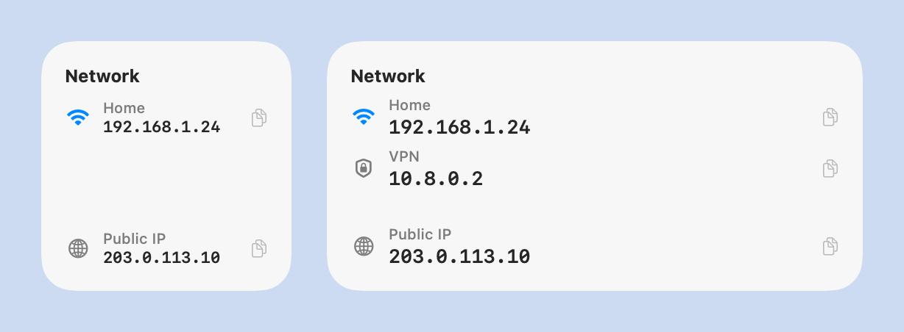

# NetWidget (WidgetKit)

Widget แบบทางการของ macOS แสดงเครือข่ายที่เชื่อมต่ออยู่และ IP address อยู่ในเมนู **Edit Widgets** วางบน desktop และ snap ตาม grid ได้เหมือน widget อื่น กดที่ IP เพื่อ copy ได้

ใช้ได้กับ macOS 14 ขึ้นไป

<picture>
  <source media="(prefers-color-scheme: dark)" srcset="docs/widget-dark.png">
  
</picture>

<sub>ภาพตัวอย่างขนาด Small และ Medium (ข้อมูลในภาพเป็นข้อมูลสมมติ)</sub>

## ส่วนประกอบ

| ส่วน | หน้าที่ |
|---|---|
| **NetWidget.app** (แอปหลัก) | อยู่ใน menu bar คอยดูว่าเครือข่ายเปลี่ยนไหม อ่านชื่อ Wi-Fi และดึง Public IP แล้วสั่งให้ widget อัปเดตทันที ตั้งให้เปิดเองตอน login ไว้ตั้งแต่เปิดครั้งแรก |
| **NetWidgetExtension** (ตัว widget) | แสดงผลบน desktop มี 2 ขนาด คือ Small (เครือข่ายหลัก + Public IP) และ Medium (สูงสุด 3 เครือข่าย + Public IP) |
| **App Group** | พื้นที่เก็บข้อมูลที่แอปหลักกับ widget ใช้ร่วมกัน |

## โครงสร้างไฟล์

```
NetWidgetKit/
├── project.yml                 # ไฟล์ตั้งค่า XcodeGen ใช้สร้าง NetWidget.xcodeproj
├── NetWidget.xcodeproj
├── App/NetWidgetApp.swift      # แอปหลัก (menu bar)
├── Widget/NetWidgetExtension.swift  # ตัว widget
└── Shared/                     # โค้ดที่ทั้งสองส่วนใช้ร่วมกัน
    ├── NetworkInfo.swift       # อ่านข้อมูลเครือข่าย, Public IP, App Group
    └── CopyIPIntent.swift      # action ตอนกดเพื่อ copy IP
```

## ติดตั้งครั้งแรก

1. เปิด Xcode → **Settings → Accounts** → กด **+** แล้วเพิ่ม Apple ID (ใช้ Apple ID ฟรีได้)
2. Build และติดตั้ง:
   ```bash
   xcodebuild -project NetWidget.xcodeproj -scheme NetWidget -configuration Release \
     -derivedDataPath build -allowProvisioningUpdates DEVELOPMENT_TEAM=<TEAM_ID> build
   cp -R build/Build/Products/Release/NetWidget.app /Applications/
   open /Applications/NetWidget.app
   ```
3. กดอนุญาตสิทธิ์ **Location** เพื่อให้แสดงชื่อ Wi-Fi ได้
4. คลิกขวาบน desktop → **Edit Widgets…** → ค้นหา **NetWidget** → ลากขนาดที่ต้องการไปวางบน desktop

## การใช้งาน

- **บน widget:** กดที่ IP เพื่อ copy จะขึ้น ✓ และคำว่า "Copied" ราว 2 วินาที
- **ใน menu bar (ไอคอน 🌐):** กดที่ IP เพื่อ copy, กด **Refresh** เพื่ออัปเดตทันที, เปิด/ปิด **Open at Login** หรือ **Quit**
- ถ้าปิดแอปหลัก widget ยังแสดงผลได้ แต่จะอัปเดตช้าลง ประมาณทุก 15 นาทีหรือตามที่ macOS กำหนด และอาจไม่มีชื่อ Wi-Fi

## แก้โค้ดแล้ว build ใหม่

ถ้าเพิ่มหรือย้ายไฟล์ ให้สร้างโปรเจกต์ใหม่จาก `project.yml` ก่อน (ต้องมี `brew install xcodegen`)

```bash
xcodegen generate
```

จากนั้น build และติดตั้งตามขั้นตอนที่ 2 แล้วรันคำสั่งนี้ให้ macOS โหลด widget ตัวใหม่:

```bash
killall NetWidget NetWidgetExtension chronod 2>/dev/null; open /Applications/NetWidget.app
```

## ข้อจำกัด

- macOS คุมหน้าตาพื้นหลัง ความใส และขอบโค้งเอง และจะทำให้ widget ดูซีดลงตอนมีหน้าต่างอื่นอยู่ข้างหน้า
- เลือกขนาดได้แค่ Small และ Medium
- ความถี่ในการอัปเดตขึ้นกับ macOS แอปหลักช่วยสั่งอัปเดตทันทีตอนเครือข่ายเปลี่ยน
